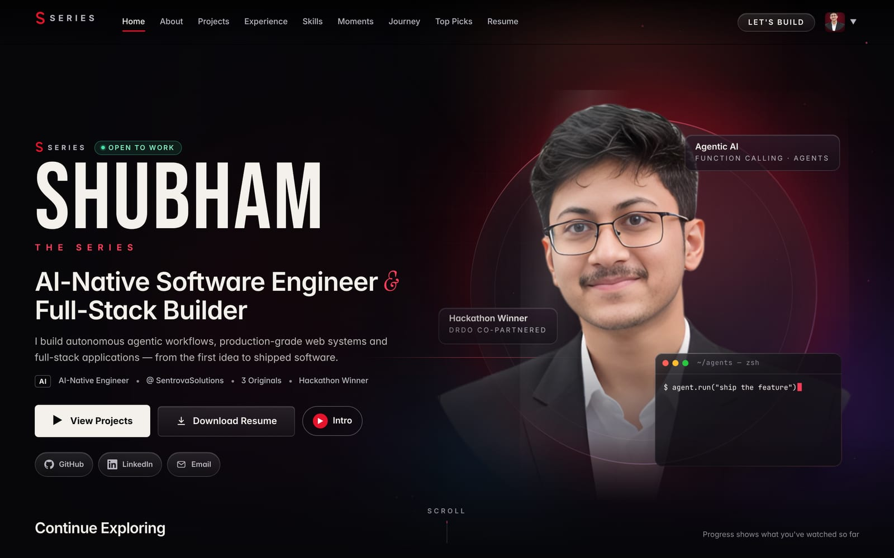
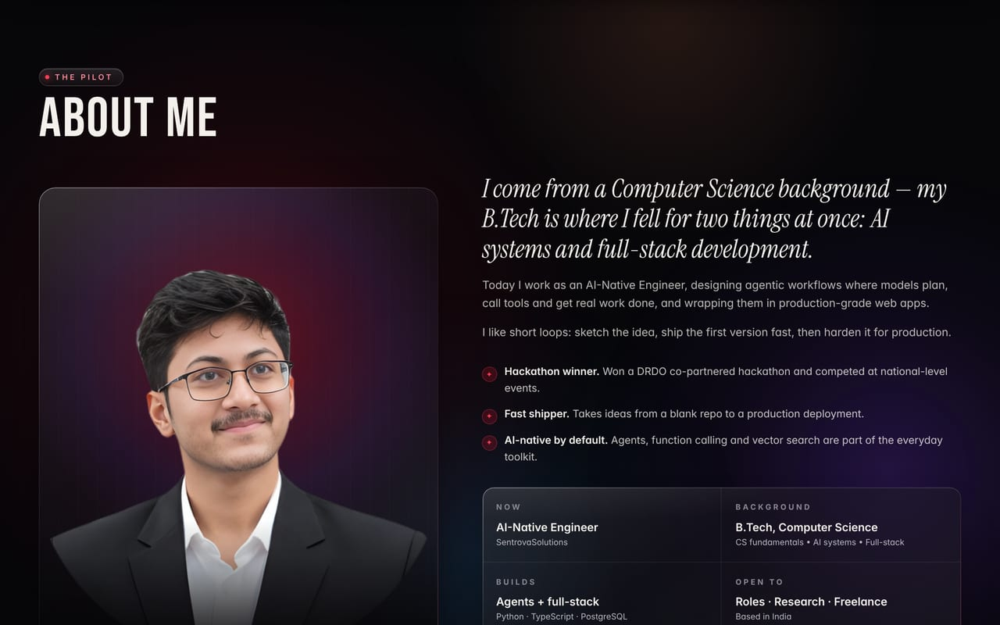
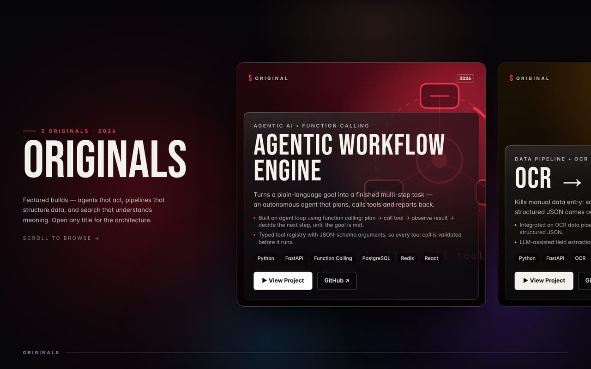
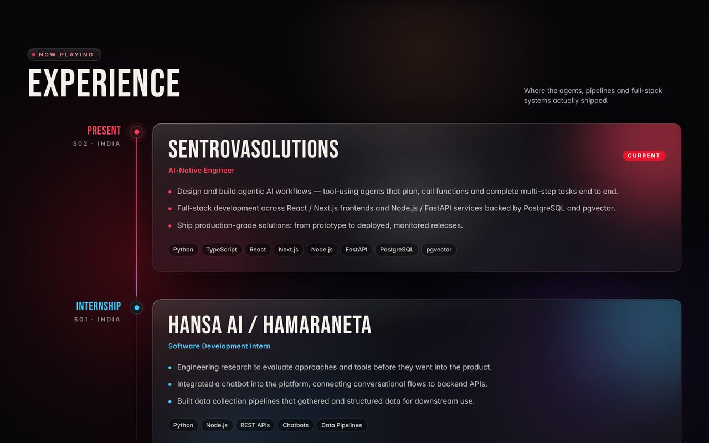
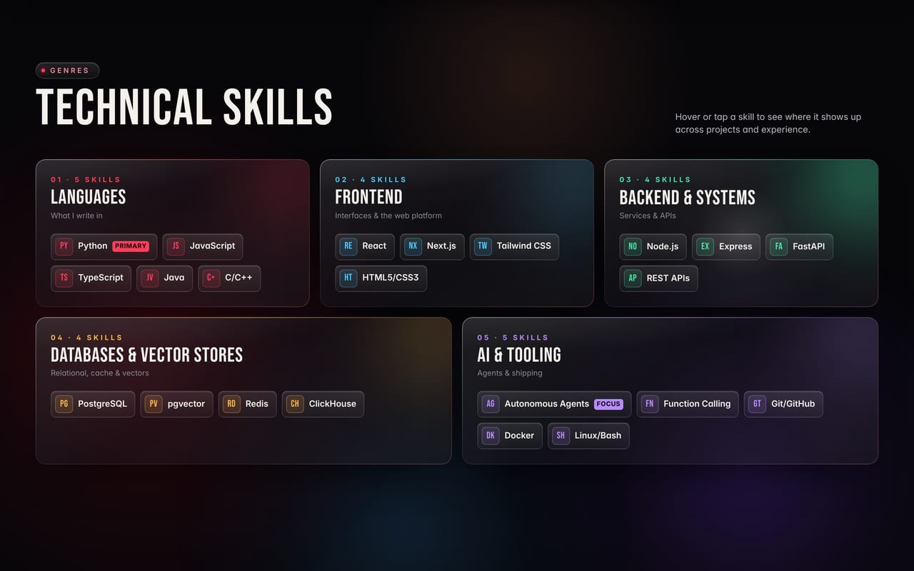
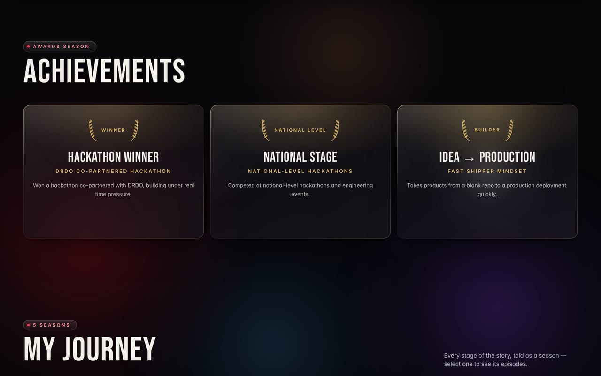
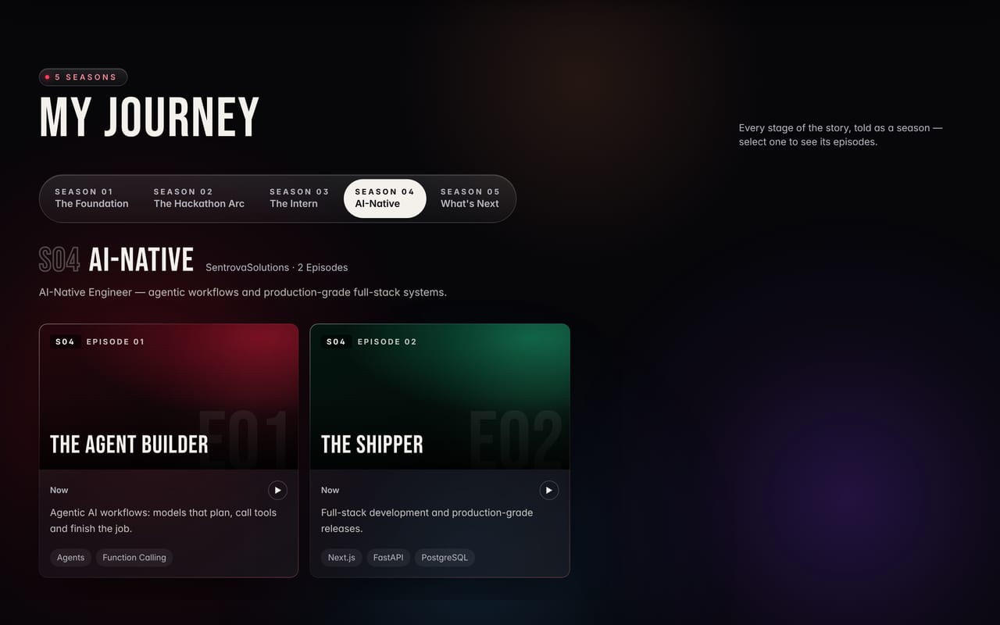
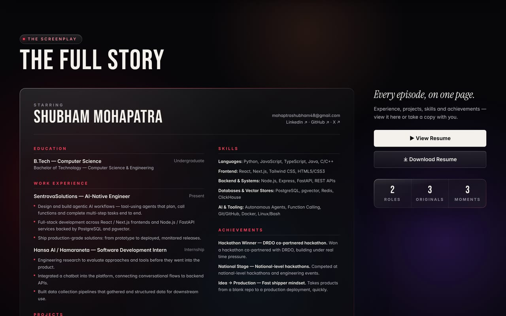
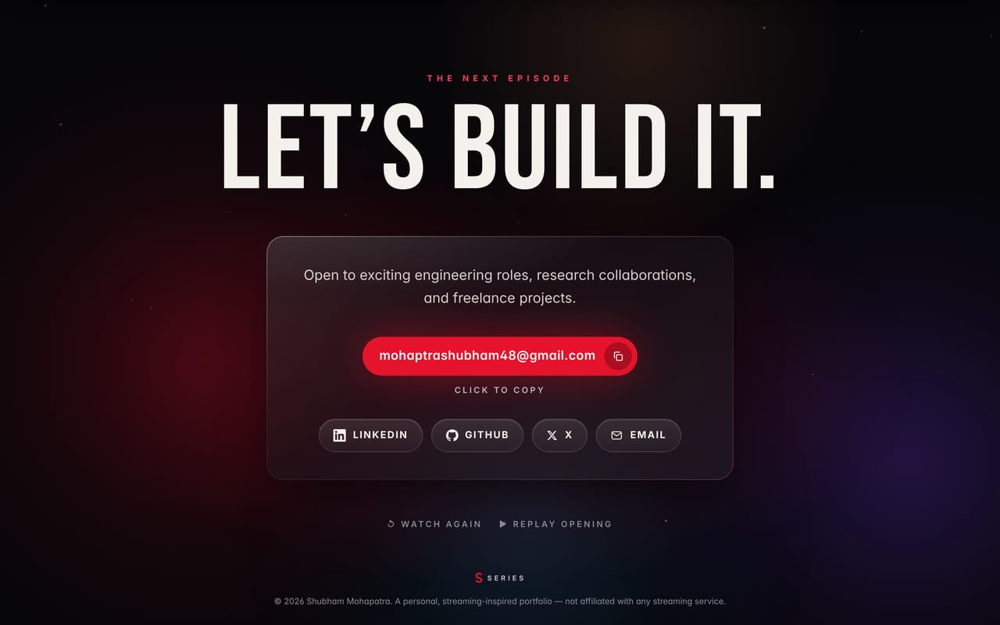
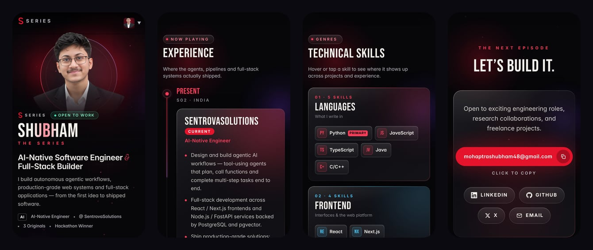

<div align="center">

# SHUBHAM — THE SERIES

**Shubham Mohapatra · AI-Native Software Engineer & Full-Stack Builder**

A cinematic, glassmorphic portfolio. Every section is an episode, every project is an Original,
and the portrait is alive: the head turns toward your cursor and the eyes blink.


</div>



## The live portrait

<table>
<tr>
<td width="44%"></td>
<td>

The hero photo is not a video. It is **170 pre-rendered frames** of one photo — 17 head turns ×
5 head tilts × eyes open/closed — made with the open LivePortrait face model.

- **Follows the cursor** left, right, up and down on a spring, so it eases in and settles naturally
- **Blinks** every few seconds, sometimes twice, like a real person
- **Glances around on its own** on phones and when the mouse is resting
- **Smooth at any speed:** frames are decoded off the main thread and every pose has a frame
  ready, so fast flicks never stutter
- **Light:** AVIF frames (~22 KB each, WebP fallback); phones download only what they use

</td>
</tr>
</table>

## Sections

| | |
| :---: | :---: |
|  |  |
| **About** — background and highlights | **Featured Projects** — pitch, stack, architecture, links |
|  |  |
| **Experience** — a timeline that draws itself as you scroll | **Technical Skills** — grouped, with where each one was used |
|  |  |
| **Achievements** | **My Journey** — the story as seasons and episodes |
|  |  |
| **The Full Story** — resume sheet, view and download | **Contact** — copy-to-clipboard email and socials |

## On a phone



## Design

- **Glassmorphism:** frosted panels with a light edge and a soft sheen, over a slowly drifting
  aurora of crimson, violet and blue that the glass refracts
- **Crisp text:** nothing at rest is blurred, scaled or 3D-transformed, so type renders natively
- **Motion with restraint:** one opening sequence, scroll reveals, a custom cursor, magnetic buttons,
  card tilt with glare on hover — all switched off for visitors who prefer reduced motion
- **Viewer profiles:** "Who's watching?" — Recruiter, Developer or Creative — reorders the sections

## Run it locally

Requires **Node.js 18+**.

```bash
npm install
npm run dev        # http://localhost:5173
```

Production build:

```bash
npm run build
npm run preview
```

The static site is written to `dist/` and deploys as-is to Vercel, Netlify, GitHub Pages or any
static host.

## Updating the content

**All content lives in one file: [`src/data/portfolio.ts`](src/data/portfolio.ts).** Every
component reads from it.

| To change… | Edit |
| --- | --- |
| Name, headline, intro, email, LinkedIn, GitHub, X | `profile` |
| Projects (Live Demo appears once `live` is set) | `projects` |
| Jobs and internships | `experience` |
| Skills and "where it's used" notes | `skillCategories`, `skillEvidence` |
| Achievements / certifications | `achievements`, `certifications` |
| Seasons and episodes (My Journey) | `seasons` |
| Top 10 row | `topPicks` |
| ▶ Play Intro highlight reel | `introSlides` |
| Section order per viewer profile | `viewerProfiles` |

- **Resume:** replace `public/assets/Shubham_Mohapatra_Resume.pdf`.
- **Static portrait:** replace `pic.png` (a transparent PNG), then run `npm run images`.
- **Live portrait frames:** see [`scripts/live-portrait/README.md`](scripts/live-portrait/README.md).

## Project structure

```
src/
  data/portfolio.ts          single source of truth for all content
  data/livePortrait.ts       frame grid for the live portrait
  App.tsx                    opening → profile select → home; overlays
  components/
    Hero                     headline, CTAs, quick links, live portrait, terminal card
    LivePortrait             canvas portrait: cursor follow, blink, off-thread decoding
    About · Experience       pilot story · scroll-drawn timeline
    Originals · ProjectCard  featured projects (pinned on desktop, swipe on touch)
    ProjectModal             full-screen project view
    Skills · Achievements    glass skill grid · award cards
    Seasons · TopPicks       journey as seasons · top 10 row
    ResumeViewer · FinalCTA  resume sheet · contact
    fx.tsx                   magnetic buttons, hover tilt + glare, text reveals, particles
  hooks/                     smooth scroll, media queries, watch progress
public/assets/live/          live portrait frames (AVIF + WebP)
scripts/                     image and live-portrait pipelines
docs/                        README screenshots and GIF
```

## Accessibility and performance

- `prefers-reduced-motion` turns off smooth scroll, the live portrait (a still photo is shown), tilt and
  particles, and stops the aurora drifting.
- Hover effects run only with a precise pointer; touch devices get taps and swipe rails.
- Overlays close with Esc; the highlight reel supports Space and ← →.
- Overlays are code-split; particles and the live portrait pause when off screen.

> A personal portfolio with a fictional streaming-platform look. It is not affiliated with Netflix or
> any other streaming service and uses none of their logos.
